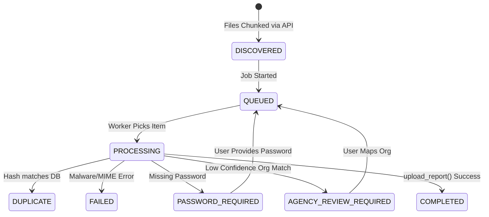

# Bulk Upload Architecture (v2)

This document outlines the architecture and workflows for the Bulk Audit Report Upload system, designed to handle 500-1000 daily PDF reports concurrently.

## Core Principles
- **No duplicated business logic**: The bulk pipeline acts as a highly concurrent pre-processor that delegates the final persistence step to the existing single-file `upload_report` service.
- **Security-First Validation**: Malware scanning (ClamAV) and deduplication (SHA256) occur strictly on raw bytes *before* any password resolution or decryption takes place.
- **In-Memory Decryption**: Passwords are never logged or stored in the database. Decrypted bytes are strictly held in-memory and passed downstream.
- **Asynchronous Scalability**: Work is driven by a resilient, background `asyncio.Queue` worker pool utilizing PostgreSQL `SKIP LOCKED` for distributed row-locking.

## System Components

### 1. Organisation Matching Service
- Compares the ML-extracted agency name against the CERT-In empanelled master list.
- **Matching Tiers**:
  1. Exact Name match (Score = 1.0)
  2. Alias match (Score = 1.0)
  3. Controlled Fuzzy match (Requires $\ge$ 95% confidence).
- If confidence is $< 95\%$, the file stops at `AGENCY_REVIEW_REQUIRED` and bubbles up the top 3 candidate matches to the UI.

### 2. Password Resolver
- Abstracted layer (`PasswordResolver`) handling both unencrypted and encrypted payloads.
- Falls back to `PASSWORD_REQUIRED` if the global password fails. Resolves passwords inline when the user provides them via the UI.

### 3. Worker Pool Manager (`BulkWorkerManager`)
- Launched on FastAPI startup (`lifespan`).
- Polls the `bulk_upload_items` table every 2 seconds for `QUEUED` items.
- Governed by the `BULK_UPLOAD_CONCURRENCY` environment variable (Default: 5).

## State Machines

### BulkUploadJob State
`CREATED` -> `PROCESSING` -> `COMPLETED` | `COMPLETED_WITH_ERRORS` | `CANCELLED`

### BulkUploadItem State

## API Specifications

1. **`POST /api/bulk-upload/jobs`** - Create batch job container.
2. **`POST /api/bulk-upload/jobs/{job_id}/files`** - Chunked payload intake (Requires `multipart/form-data`). Writes immediately to temporary disk storage.
3. **`POST /api/bulk-upload/jobs/{job_id}/start`** - Triggers worker queue ingestion.
4. **`POST /api/bulk-upload/jobs/{job_id}/cancel`** - Halts all pending processing.
5. **`GET /api/bulk-upload/jobs/{job_id}/items`** - Server-side paginated retrieval of items.
6. **`POST /api/bulk-upload/items/{item_id}/retry`** - Resolves blockers (inline password processing or manual ID mapping).
7. **`POST /api/bulk-upload/jobs/{job_id}/retry-failed`** - Automatically requeues all transient network/DB errors.

## Tuning & Optimization
To increase throughput:
1. Benchmark the `AI_PIPELINE` using `scripts/test_bulk_upload_load.py`.
2. Increase `BULK_UPLOAD_CONCURRENCY` in `app/config.py`.
3. If concurrency exceeds 15, bump the SQLAlchemy `pool_size` in `app/database.py` to prevent API starvation.
