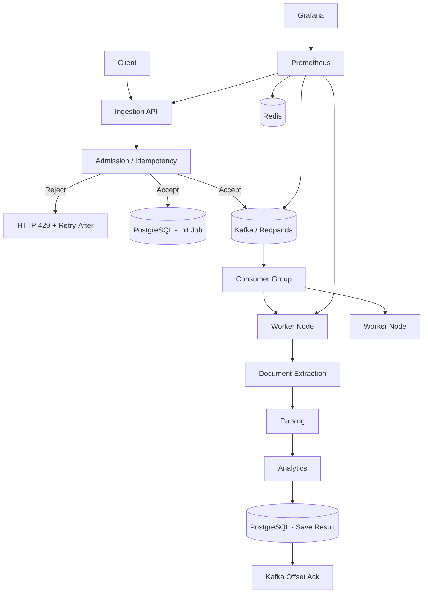

# System Architecture

## Logical Components

The system implements an asynchronous, event-driven architecture to decouple bursty ingestion from heavy processing.

## Component Roles

1. **Ingestion API:** Fast, lightweight HTTP server. Validates payloads, checks idempotency via Redis, records the initial job state in PostgreSQL, and pushes the event to Kafka. Implements strict admission control.
2. **Kafka/Redpanda:** The durable asynchronous processing queue. Buffers the bursts and partitions the workload.
3. **Worker Nodes:** Heavy processing nodes consuming from Kafka. Executes extraction, parsing, and analytics. Interacts with PostgreSQL to record terminal states and Redis for ephemeral state.
4. **PostgreSQL:** The durable source of truth. Holds all final job states, metadata, and results.
5. **Redis:** Ephemeral idempotency cache and rate-limit counters layer.

## Offline/Air-Gap Compatibility
The architecture introduces no runtime dependencies on external cloud services. All components (Kafka, Redis, PostgreSQL, Prometheus, Grafana, API, Workers) are fully containerised and run locally on the provided infrastructure.
